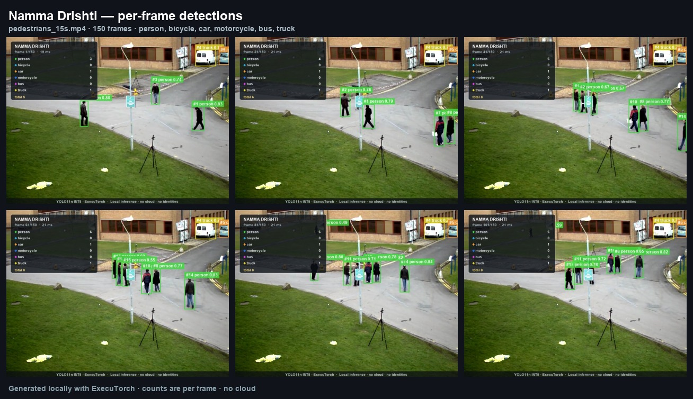
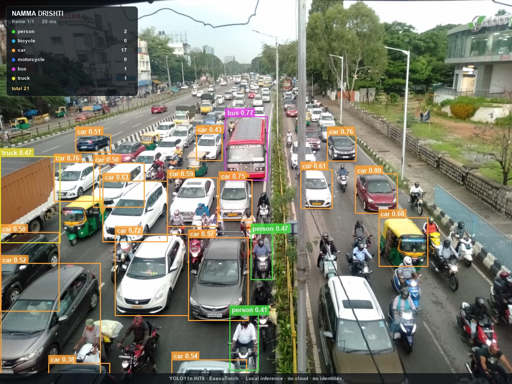
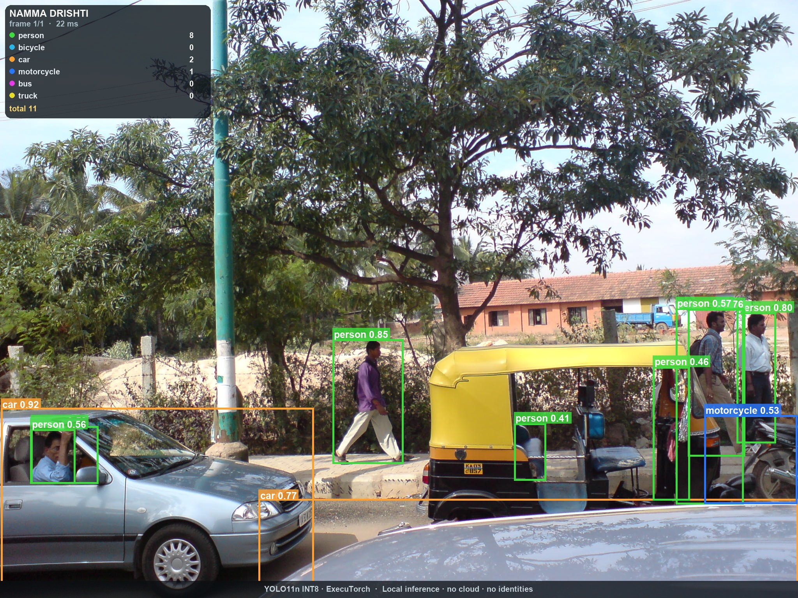
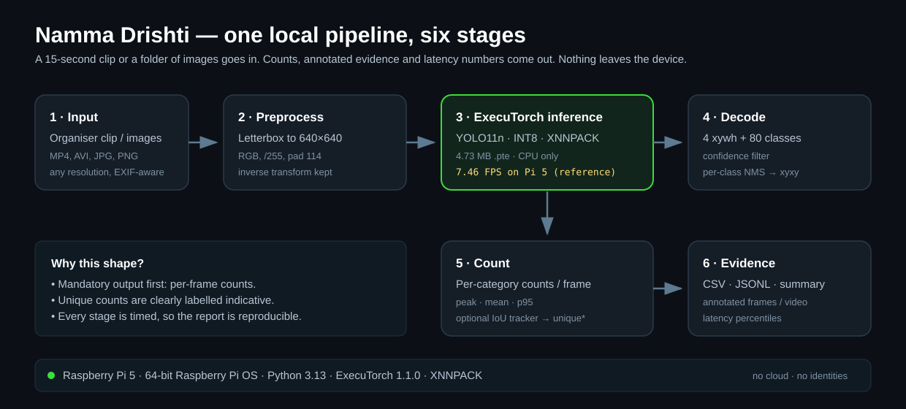

<p align="center">
  
</p>

<h1 align="center">Namma Drishti</h1>

<p align="center">
  <strong>Offline edge object detection &amp; counting for safer streets.</strong><br>
  ExecuTorch · YOLO11n INT8 · Raspberry Pi 5 · zero cloud · zero identities.
</p>

<p align="center">
  <a href="docs/proposal.md">Proposal</a> ·
  <a href="docs/report.md">Technical report</a> ·
  <a href="docs/pitch-2min.md">2-minute pitch</a> ·
  <a href="docs/judge-brief.md">Judge brief</a> ·
  <a href="docs/submission-checklist.md">Submission checklist</a> ·
  <a href="results/demo.mp4">Demo video</a>
</p>

---

> **The short version.** A 15-second phone clip of a street goes in. Per-category counts, annotated evidence and honest latency numbers come out — all on a sub-₹10,000 Raspberry Pi, with no network connection and no personal data leaving the device.
>
> On the committed sample clip: **150 frames processed, 18 tracked people (indicative), 2 tracked vehicles, 4.73 MB model, 7.46 FPS reference on Pi 5.**



## The problem

Road traffic injuries are the **leading cause of death for children and young adults aged 5–29** (WHO). India reported **1,68,491 road deaths in 2022**; pedestrians were **19.5%** of them and two-wheeler riders **44.5%** (MoRTH, *Road Accidents in India 2022*). Yet the everyday data needed to make a street safer — *how many people cross here, when, and alongside how much traffic* — is usually locked behind expensive cameras, proprietary dashboards or continuous cloud connectivity.

A ward officer, school principal or resident welfare association does not need a surveillance platform. They need a cheap, offline way to **count movement**, compare a few times of day, and make one concrete decision: add a crossing guard, shift a speed hump, widen a footpath, or fix a blind corner.

## What this project does

Namma Drishti is a deliberately small edge-AI PoC for **pedestrian and vehicle counting**:

- Processes one **10–20 second clip** or a **folder of 10–20 images**.
- Detects six COCO categories: **person, bicycle, car, motorcycle, bus, truck**.
- Prints **per-frame counts** and writes them to CSV/JSON.
- Saves **annotated frames, a contact sheet and an optional annotated video**.
- Reports **model-only latency, full-pipeline latency, p50/p95, throughput and memory**.
- Optionally reports **indicative unique counts** with a lightweight IoU/velocity tracker.
- Runs **entirely locally** on CPU through ExecuTorch and XNNPACK.

No live camera, no tracking platform, no dashboard, no cloud. Those are explicitly out of scope in the brief; the effort goes into a reliable, measurable, reproducible detector instead.

## Results at a glance

| What | Value | Where it comes from |
|---|---|---|
| Model | **YOLO11n (COCO, 80 classes), INT8 static PTQ** | Ultralytics YOLO11n, optimized by Arm |
| Model file | **4.73 MB** `.pte`, SHA-256 `154c54b5…41b96` | `models/yolo11n_int8_xnnpack.pte` |
| Reference accuracy | **mAP@0.5:0.95 38.90%**, mAP@0.5 54.66% (COCO val2017) | Arm model card |
| Pi 5 reference latency | **134.10 ms p50**, **7.46 FPS**, 1 thread | Arm model card, ExecuTorch 1.1.0 |
| Pi 5 reference peak memory | **59.17 MB** | Arm model card |
| This repo, dev host (Apple Silicon) | **20.34 ms mean model-only**, 49.16 FPS | `results/benchmark_dev.json` — *not a Pi measurement* |
| This repo, full pipeline (dev host) | **25.39 ms mean**, 39.38 FPS | `results/demo_pedestrians/summary.json` |
| Sample clip result | 150 frames · peak 9 people/frame · **18 tracked people (indicative)** · 2 tracked vehicles | `results/demo_pedestrians/summary.json` |

> **Read the labels.** The Pi 5 numbers are Arm's published reference for the prebuilt model. The dev-host numbers are what this repository measured on an Apple Silicon machine. The repo includes the exact benchmark harness so the team can replace the dev row with an on-device Pi row at the finals. We do not present dev-host numbers as Pi performance.

<p align="center">
  
  
</p>

<p align="center"><em>Left: a dense Bengaluru traffic scene — 17 cars, 1 bus, 1 truck, 2 people. Right: a street scene — 8 people, 2 cars, 1 motorcycle. The auto-rickshaw is not a COCO class; that gap is discussed in the report.</em></p>

## Quickstart

### On a Raspberry Pi 5 (recommended)

64-bit Raspberry Pi OS (Trixie or Bookworm), Python 3.10–3.13, ~2 GB free disk.

```bash
git clone <your-github-url> namma-drishti
cd namma-drishti
bash scripts/setup_pi.sh

source .venv/bin/activate
namma-drishti doctor
namma-drishti run -i data/samples/pedestrians_15s.mp4 \
  -o results/pi_run --save-video
namma-drishti benchmark --input data/samples/bengaluru_traffic.jpg --runs 50
```

`setup_pi.sh` creates a venv, installs the pinned ExecuTorch 1.1.0 + CPU PyTorch
wheels, installs the package, verifies the model checksum and runs a smoke test.
The model is committed, so the demo works without downloading anything.

### On a development host (macOS Apple Silicon / Linux x86_64)

```bash
python3 -m venv .venv
source .venv/bin/activate
pip install -r requirements-dev.txt
pip install -e .
namma-drishti doctor
make demo
```

The prebuilt model loads on ExecuTorch 1.5.1 in our Mac tests; the Pi pins 1.1.0
to match Arm's model card. Both are exercised by the report.

### Commands that matter

```bash
# One clip, all six categories, annotated video + evidence bundle
namma-drishti run -i clip.mp4 -o results/clip --save-video

# One image
namma-drishti run -i street.jpg -o results/street --annotate-every 1

# A folder of 10–20 images (the other allowed input mode)
namma-drishti run -i data/images/ -o results/images --annotate-every 1

# Faster survey: every second frame, 100 frames max
namma-drishti run -i clip.mp4 -o results/fast --stride 2 --max-frames 100

# Model-only latency, 50 measured runs after 10 warmups
namma-drishti benchmark --input street.jpg --runs 50 --warmup 10

# Model and runtime metadata
namma-drishti info --json
```

Every run writes:

```
results/<run>/
├── summary.txt          # terminal table, human-readable
├── summary.json         # machine-readable metrics + environment
├── counts.csv           # per-frame counts and stage timings
├── detections.jsonl     # boxes, scores, optional track IDs
├── REPORT.md            # self-contained Markdown report
├── contact_sheet.jpg    # 3–6 annotated frames
├── annotated/           # full-resolution annotated frames
└── annotated.mp4        # optional annotated clip
```

## How it works



1. **Read** — OpenCV for video, PIL + EXIF transpose for phone images.
2. **Letterbox** — aspect-preserving resize to 640×640, RGB, `/255`, 114-grey pad.
3. **Infer** — ExecuTorch `.pte` with XNNPACK; model-only timer around `execute`.
4. **Decode** — 4 xywh + 80 class scores, confidence filter, per-class NumPy NMS, inverse letterbox.
5. **Count** — per-category counts per frame; optional IoU/velocity tracker for indicative unique counts.
6. **Write** — CSV, JSONL, annotated frames/video, latency percentiles, model/environment metadata.

The model is fixed-input (640×640) and the preprocessing is matched to Arm's
export contract — including the 114-grey pad and no mean/std normalisation.
Getting that order wrong silently shifts boxes; the preprocessing is unit-tested
against the expected transform.

## Why this is different

- **It is actually ExecuTorch on the edge.** The primary artifact is a 4.73 MB INT8 `.pte` running through the ExecuTorch runtime with XNNPACK — not a PyTorch script on a laptop with “edge” in the title.
- **It uses Arm's verified optimization.** We start from Arm's pre-optimized YOLO11n INT8 build for Raspberry Pi 5, with a model card reporting 2.23× speedup and 1.56× lower peak memory over the FP32 baseline.
- **It measures the whole pipeline, not just the model.** Preprocess, inference, decode/NMS, tracking and annotation are timed separately, so the throughput claim is auditable.
- **It is privacy-preserving by construction.** No faces, no plates, no identities, no network calls. The default output is aggregate counts and a handful of annotated frames.
- **It is honest about accuracy.** We report COCO reference mAP, not a made-up “accuracy” on the organiser clip, and we show the model's India-specific failure mode (auto-rickshaws are not a COCO class).
- **It is a kit, not a one-off script.** One-command setup, tests, sample media, checksum verification, model-agnostic `.pte` loading, and a documented fallback export path.

## Mandatory deliverables — where to find them

| # | Requirement | Artifact |
|---|---|---|
| 1 | Process an organiser 10–20 s clip **or** 10–20 images on ExecuTorch + Pi | `data/samples/pedestrians_15s.mp4`; `namma-drishti run`; `results/demo_pedestrians/` |
| 2 | Detect at least one category and display counts per frame | `counts.csv`, `summary.txt`, HUD in `annotated/` |
| 3 | Submit category + counts + at least two sample outputs | `results/demo_pedestrians/contact_sheet.jpg`, `results/demo_traffic/annotated/…`, `results/demo_street/annotated/…` |
| 4 | Report average inference time, model and approximate throughput | `results/demo_pedestrians/summary.json` → `latency`, `throughput`; `results/benchmark_dev.json` |
| 5 | Explain societal issue, how counting helps, one practical application (≤2 min) | `docs/pitch-2min.md`; `docs/report.md` §1 and §7 |

The full mapping, including what to say at the booth, is in
[`docs/submission-checklist.md`](docs/submission-checklist.md).

## Repository map

```
.
├── src/namma_drishti/        # package: preprocess, model, decode, tracker, pipeline, report
├── tests/                    # 21 unit tests for preprocessing, NMS, tracking, metrics
├── scripts/
│   ├── setup_pi.sh           # one-command Pi setup
│   ├── download_model.sh     # fetch + verify the Arm .pte
│   ├── export_model.py       # optional YOLO11n → ExecuTorch FP32 fallback
│   ├── fetch_samples.sh      # re-fetch the public sample media
│   └── make_demo_video.py    # title + annotated clip + end card
├── models/                   # 4.73 MB INT8 .pte, model card, AGPL notice
├── data/samples/             # 15 s pedestrian clip + two CC0/PD Bengaluru images
├── results/                  # committed evidence bundles and demo video
├── docs/                     # proposal, report, pitch, research, checklist
└── assets/                   # icon and architecture diagram
```

## Reproducibility and methodology

- **Model:** YOLO11n COCO, statically quantized to INT8 by Arm; stem conv and
  detection head remain FP32. The `.pte` checksum is verified at load time and
  shown in every summary.
- **Warmup:** 3 inferences before the pipeline; 10 in the standalone benchmark.
- **Latency:** model-only timer around `Method.execute`; pipeline timer includes
  read, preprocess, inference, decode/NMS, tracking and annotation. p50/p95 are
  reported because a single mean hides scheduling noise. Annotated-video
  encoding is an output step and is excluded from the pipeline timer.
- **Throughput:** model-only FPS = 1000 / mean inference ms; pipeline FPS =
  1000 / mean total ms. Both are reported, never conflated.
- **Tracking:** optional and video-only; images are independent frames. Unique
  counts are indicative, not production MOT.
- **Memory:** `ru_maxrss` for the process is reported separately from Arm's
  model-only peak memory; Python/PyTorch overhead makes process RSS higher.
- **Tests:** `make test` — 21 passing tests on preprocessing, NMS, decode, tracker
  identity and metrics.
- **Runtime parity:** the exact Pi stack (ExecuTorch 1.1.0 + torch 2.10.0) was
  smoke-tested on the dev host: 3 frames end-to-end, same output shape and
  counts, 21.67 ms mean model latency. Only the Pi timing remains to be measured.
- **Provenance:** model URL + SHA-256, sample media licences and source URLs are
  in `models/README.md` and `data/README.md`.

## Limitations and responsible AI

- **COCO is not India.** Auto-rickshaws, hand carts and many local vehicle types
  are not COCO classes. In the dense traffic sample, the model finds 17 cars but
  **0 motorcycles** — small, occluded riders are a known failure mode. Do not use
  this PoC for enforcement or as a complete traffic census.
- **No ground-truth mAP on organiser data.** We report the model card's COCO
  mAP and qualitative sample outputs. At the finals, the organiser clip will be
  processed and its counts reported as counts, not as accuracy.
- **Unique counts are indicative.** The IoU/velocity tracker is not a production
  MOT system; IDs can switch when people cross or leave frame.
- **Aggregate only.** No face recognition, no licence plate recognition, no
  identity persistence. Frames are processed in memory; only requested evidence
  is written. The tool is a decision-support aid, not a surveillance product.
- **Licence.** The YOLO11n weights and the Arm-optimized `.pte` are AGPL-3.0.
  This repository is AGPL-3.0 to comply. For a permissive deployment, swap in a
  permissively licensed detector and re-export; the CLI accepts any YOLO-style
  `.pte` output.

## Team

Built for the **Namma AI Hackathon — AI for Safer Communities** (Problem
Statement 2), 14 November 2026, Bengaluru.

- `[Team name]`
- `[Member 1 — role]`
- `[Member 2 — role]`
- `[Member 3 — role]`
- `[College / organisation]`

Replace the placeholders before submitting. The proposal and form-answer drafts
are in [`docs/proposal.md`](docs/proposal.md) and
[`docs/form-answers.md`](docs/form-answers.md).

## Credits

- **Arm** — YOLO11n INT8 ExecuTorch model, model card and Raspberry Pi 5 benchmarks.
- **Ultralytics** — YOLO11n architecture and COCO weights (AGPL-3.0).
- **PyTorch / ExecuTorch** — runtime, XNNPACK delegate and tooling.
- **OpenCV** — pedestrian sample clip (`vtest.avi`).
- **Wikimedia Commons** — Bengaluru traffic image (CC0) and street image (public domain); attribution in `data/README.md`.
- **Namma AI Hackathon / NASSCOM CoE IoT, IIIT Bangalore, Arm** — problem statement and programme.

## Licence

GNU Affero General Public License v3.0. See [`LICENSE`](LICENSE) and
[`models/README.md`](models/README.md) for the model-specific notice.
