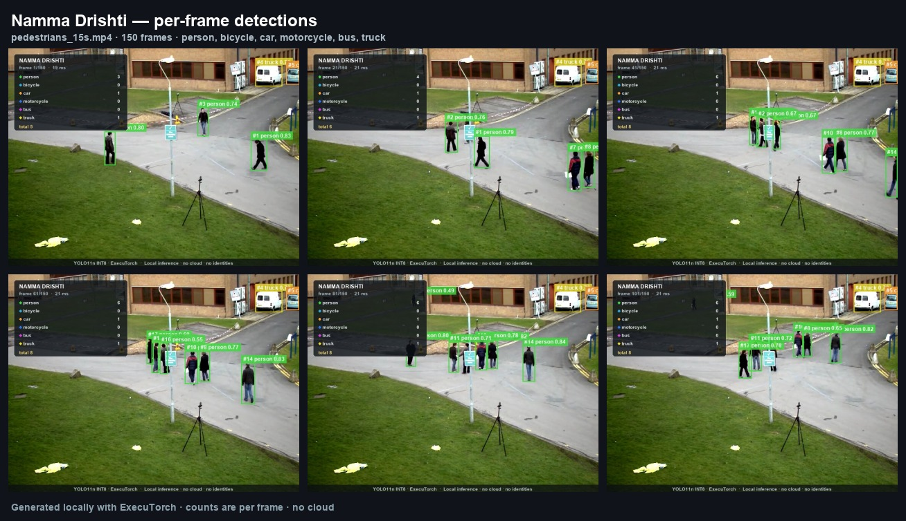
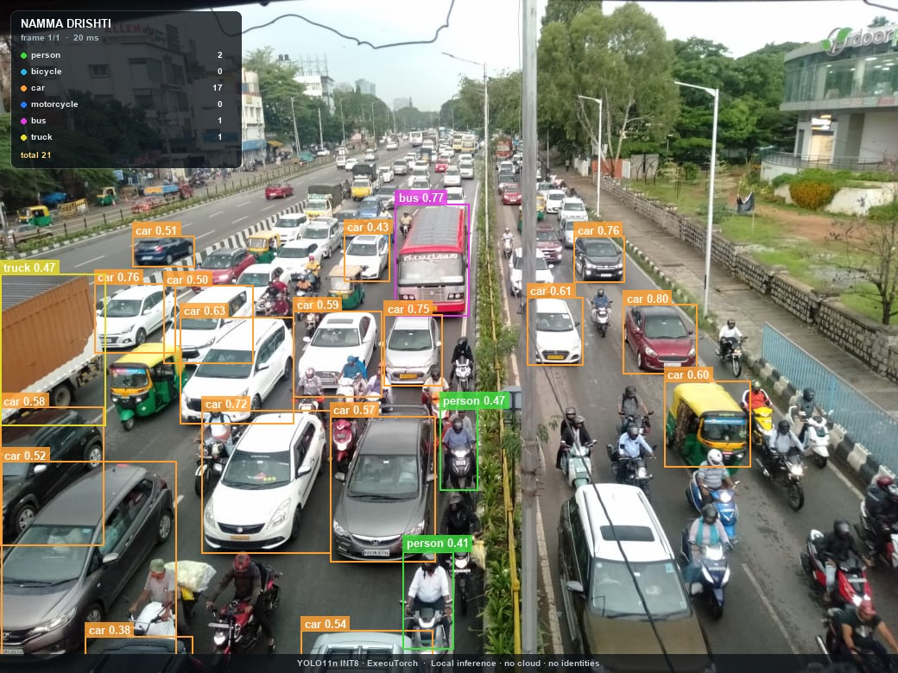

# Namma Drishti

### Offline edge detection and counting for safer streets

**Namma AI Hackathon 2026 · Problem Statement 2 — AI for Safer Communities**

**Team:** [Team name] · [Member 1], [Member 2], [Member 3] · [College / organisation]

---

## One line

Namma Drishti turns a 15-second phone clip of any street into an offline,
privacy-preserving count of pedestrians and vehicles on a Raspberry Pi — no
cloud, no GPU and no identities.

## 1. The problem

Road traffic injuries are the leading cause of death for children and young
adults aged 5–29 worldwide (WHO). India reported **1,68,491 road deaths in 2022**
(MoRTH); pedestrians were **19.5%** of the people killed and two-wheeler riders
**44.5%**. These are not abstract numbers. They are the school gate, the market
junction and the bus stop.

The data needed to make a specific street safer is simple: *how many people
cross here, when, and alongside how much traffic?* Yet that data is usually
locked behind expensive cameras, proprietary dashboards or continuous cloud
connectivity. A ward officer, school principal or resident welfare association
cannot justify a surveillance platform. They can justify a sub-₹10,000 computer
and a 15-second clip.

## 2. The insight

**Count movement, not people.**

We do not need face recognition, licence plates or persistent identities to make
a road safer. Aggregate counts at different times of day are enough to prioritise
a crossing guard, a zebra crossing, a speed hump or a footpath repair. That makes
the problem a natural fit for a small, offline edge detector — and it lets us
design for privacy from the first line of code.

## 3. What we will build

A functional PoC that satisfies every mandatory deliverable:

1. **Input:** one organiser-provided 10–20 second clip, or 10–20 images. The
   committed sample clip is 15 seconds / 150 frames.
2. **Detection:** six COCO categories — person, bicycle, car, motorcycle, bus,
   truck — with per-frame counts for each.
3. **Evidence:** terminal table, `counts.csv`, `detections.jsonl`, annotated
   frames, a contact sheet and an optional annotated video.
4. **Performance:** model-only and full-pipeline latency (mean, p50, p95),
   throughput, model size, checksum and process memory.
5. **Explanation:** a two-minute societal-impact pitch and a technical report
   with limitations.

Optional refinements that make the counts more useful without overbuilding:

- A lightweight IoU/velocity tracker for **indicative unique counts** across a
  clip. Clearly labelled as indicative, never presented as production MOT.
- **Observed person-seconds / vehicle-seconds** for the clip, so two clips of
  different lengths can be compared without pretending to extrapolate a full day.
- A **self-contained run report** (`REPORT.md`) generated from the same JSON that
  drives the terminal output, so every number is traceable.

## 4. Why ExecuTorch on a Raspberry Pi

The primary artifact is **Arm's pre-optimized YOLO11n INT8 ExecuTorch model**
(4.73 MB), not a PyTorch script running on a laptop.

| Property | Value |
|---|---|
| Model | YOLO11n, 80-class COCO detector |
| Quantization | INT8 static PTQ; stem conv and detection head in FP32 |
| Runtime | ExecuTorch 1.1.0, XNNPACK + KleidiAI, CPU only |
| Pi 5 reference latency | **134.10 ms p50 · 7.46 FPS** |
| Pi 5 reference peak memory | **59.17 MB** |
| COCO accuracy | **38.90% mAP@0.5:0.95 · 54.66% mAP@0.5** |
| Model size | **4.73 MB** |

At 7.46 FPS, a 15-second / 150-frame clip takes about 20 seconds of model time
on a Pi 5. That is comfortably inside a one-day hackathon, and fast enough to
process a handful of clips during a school-zone audit. There is no GPU, no
accelerator and no network dependency — just the Pi's Cortex-A76 cores and
XNNPACK.

We deliberately chose a **pre-optimized, verified artifact** over a larger model
that would look better on paper but fail on the target. The model card publishes
p50, p90, p99, load time, memory and accuracy, so the proposal's performance
claims are anchored to the target device, not a laptop.

## 5. How it works

```
clip/images
   → letterbox 640×640 (RGB, /255, 114 pad)
   → ExecuTorch .pte (YOLO11n INT8, XNNPACK)
   → decode 4 xywh + 80 classes
   → confidence filter + per-class NMS
   → per-frame counts (+ optional IoU tracker)
   → CSV / JSONL / annotated frames / video / latency report
```

The pipeline is a small, tested Python package. Preprocessing is matched to the
export contract (including the 114-grey pad and no mean/std normalisation);
getting that wrong silently shifts boxes. Decode and NMS are NumPy, so the Pi
install stays small. The CLI accepts any YOLO-style `.pte` with an `[N, 84]` or
`[N, 85]` output, so if the organisers approve a different model, we change one
argument — not the application.

## 6. What is already built

This is not a slideware proposal. The repository already contains:

- A working ExecuTorch pipeline tested on the committed clip and two Bengaluru
  images.
- **21 passing unit tests** for letterboxing, NMS, decode, tracker identity and
  metrics.
- A one-command Raspberry Pi setup script with a pinned runtime, checksum
  verification and a smoke test.
- A reproducible evidence bundle: per-frame CSV, detections JSONL, annotated
  frames, contact sheet, annotated video and a generated Markdown report.
- A dev-host benchmark: **20.34 ms mean model-only, 49.16 FPS** on Apple
  Silicon (explicitly labelled as not a Pi measurement).
- A smoke test of the **exact Pi runtime stack** (ExecuTorch 1.1.0 + torch
  2.10.0) on the dev host: 3 frames end-to-end, same output shape and counts.
- A 21-second demo video with title card, live detections, counts and an end card.

At the finals we will run the same commands on the organiser clip on the Pi,
replace the dev-host row with on-device numbers, and show the raw CSV next to the
annotated frames. The one-day event becomes a deployment and validation exercise,
not a from-scratch build.





## 7. Practical application: the school-zone safety audit

**Who benefits:** a school management committee, a ward road-safety officer or a
resident welfare association.

**The workflow:**

1. Record three 15-second clips at the school gate: morning drop-off, afternoon
   dismissal and a quiet hour.
2. Run each clip on the Pi. No internet, no footage leaves the school.
3. Compare peak concurrent pedestrians, vehicle counts and observed
   person-seconds across the three clips.
4. If dismissal shows a high pedestrian count with a high vehicle count, that is
   evidence for a crossing guard at 3:30 pm, a zebra crossing, or a no-parking
   zone within 20 metres of the gate.

The output is not a dashboard. It is a one-page count table and a handful of
annotated frames that a non-technical committee can read in two minutes.

## 8. Six-hour execution plan at the finals

| Time | Work | Output |
|---|---|---|
| 0:00–0:45 | Flash/verify Pi, run `setup_pi.sh`, `doctor`, load model | Green environment |
| 0:45–1:30 | Run organiser clip, verify counts and annotated frames | First real result |
| 1:30–2:30 | Tune confidence threshold on 2–3 frames, freeze settings | Defensible config |
| 2:30–3:30 | Run full clip, benchmark 50 runs, save evidence bundle | CSV/JSON/video |
| 3:30–4:30 | Fill report tables, replace dev-host numbers, build contact sheet | Final report |
| 4:30–5:30 | Rehearse 2-minute pitch, prepare backup USB with outputs | Pitch ready |
| 5:30–6:00 | Buffer: rerun, fix, export | Submission |

**Fallbacks:** prebuilt INT8 model committed; FP32 Ultralytics export script if
needed; all evidence pre-generated on the dev host on a USB stick; the pipeline
runs on x86_64 too if the Pi fails.

## 9. Risks and mitigations

| Risk | Mitigation |
|---|---|
| ExecuTorch/PyTorch install is slow or fails on Pi | Pin known-good versions in `requirements-pi.txt`; setup script is idempotent; pre-download wheels on the dev host as a backup |
| Model misses small/occluded objects | Report it honestly; use close-range clips for the demo; document 640 input and tiling as future work |
| Auto-rickshaws are not a COCO class | Call it out as a limitation; do not fake a category; propose fine-tuning on Indian roads as next step |
| Organiser clip is a different codec/resolution | OpenCV handles common codecs; `read_image` honours EXIF; `--stride` and `--max-frames` control cost |
| Counts are challenged | Show per-frame CSV, annotated frames and the exact command; never claim accuracy without ground truth |
| Pi 4 instead of Pi 5 | The pipeline runs on aarch64 Pi 4; report lower throughput honestly; Pi 5 is the reference target |

## 10. Responsible AI

- **No identity extraction.** No face recognition, no licence plates, no
  re-identification. The default output is aggregate counts.
- **Local by construction.** No network calls in the inference path. The demo can
  run with the Wi-Fi disabled.
- **Aggregate, not enforcement.** The tool is a decision-support aid for
  infrastructure planning, not a policing or enforcement system.
- **Honest accuracy.** We report COCO mAP from the model card, not a fabricated
  accuracy on the organiser clip. We show failure cases, including the dense
  Bengaluru scene where motorcycles are missed.
- **Licence compliance.** YOLO11n and the Arm `.pte` are AGPL-3.0; the repository
  is AGPL-3.0 and the model notice is included.

## 11. Team

| Member | Role | Relevant experience |
|---|---|---|
| [Member 1] | Edge/runtime, Pi deployment | [fill] |
| [Member 2] | Computer vision, evaluation | [fill] |
| [Member 3] | Product, societal application, pitch | [fill] |

## Appendix — mandatory deliverable map

| Requirement | Where |
|---|---|
| Process 10–20 s clip or 10–20 images | `data/samples/pedestrians_15s.mp4`; `namma-drishti run` |
| Detect at least one category + per-frame counts | `counts.csv`, `summary.txt`, HUD |
| Category + counts + 2 sample outputs | `results/demo_pedestrians/contact_sheet.jpg`, `results/demo_traffic/annotated/…`, `results/demo_street/annotated/…` |
| Average inference time, model, throughput | `summary.json`, `summary.txt`, `benchmark_dev.json` |
| 2-minute societal explanation | `docs/pitch-2min.md` |

**Links:** GitHub `[insert URL]` · Demo video `results/demo.mp4` · Technical
report `docs/report.md` · Research notes `docs/research.md`
