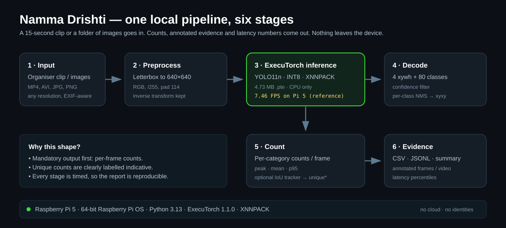

# Arten

### Edge Object Detection, Counting & Attributes

**Author:** Sujal M H · Solo participant

**Namma AI Hackathon 2026 · Problem Statement 2 — AI for Safer Communities**

---

## Abstract

Arten is an offline edge-AI proof of concept that detects, counts and attributes
pedestrians and vehicles in a short street clip or image set. A compact YOLO11n
INT8 ExecuTorch model runs on a Raspberry Pi 4 or 5 CPU; a source-built ARMv8.0
runtime covers Pi 3/4 when the prebuilt wheel cannot run. The pipeline writes
per-frame counts, on-device direction, dwell and relative-speed attributes,
optional coarse vehicle colour, and annotated frames. A tiled mode runs
native-resolution crops and merges the boxes, trading latency for recall on
dense scenes. On the committed clip it processes 150 frames, peaks at 10 people
in one frame and produces 33 indicative person tracks plus two background
vehicles. Arm's model card reports the Pi 5 reference: **134.10 ms p50 /
7.46 FPS**, **59.17 MB** peak memory and **38.90% mAP@0.5:0.95**.

## 1. Problem and application

Road traffic injuries are the leading cause of death for people aged 5–29
worldwide (WHO). India recorded **1,68,491 road deaths in 2022**; pedestrians
were **19.5%** of the fatalities and two-wheeler riders **44.5%** (MoRTH).

A school, ward office or resident group does not need another surveillance
platform. It needs a cheap, repeatable answer to one question: *how many people
cross here, when, and alongside how much traffic?* That answer is usually locked
behind expensive cameras, proprietary dashboards or continuous cloud
connectivity.

**Application.** A school records three short clips at the same gate: morning
drop-off, afternoon dismissal and a quiet hour. It runs them locally on a
Raspberry Pi. The output is a count table, movement attributes and a few
annotated frames. A high pedestrian/vehicle overlap at dismissal supports an
on-site review for a crossing guard, a zebra crossing or a no-parking zone. The
clip supplies evidence for that review; it does not estimate near-misses or
crash risk.

## 2. Approach

The design makes five choices:

1. **Use an edge artifact.** Arm's pre-optimized YOLO11n INT8 `.pte` is small
   enough for a Pi and verified on the target. A larger YOLOv8s `.pte` is an
   optional accuracy upgrade; the CLI resolves either model from its checksum.
2. **Make counts the first-class output.** Per-frame counts come directly from
   detections, independent of tracking quality.
3. **Add attributes on the same tracker.** Direction, dwell and relative speed
   reuse the existing tracker. Optional colour is classical HSV. No second
   model.
4. **Calibrate and tile when needed.** The default confidence is 0.2, tuned on
   real street frames. A 2×2 or 3×3 tiled pass recovers small objects on dense
   frames at 4× or 9× the cost.
5. **Ship evidence.** Every run writes counts, detections, attribute rows,
   latency percentiles and annotated frames.

| Property | Value |
|---|---|
| Model | YOLO11n (default); YOLOv8s accuracy option |
| Quantization | INT8 static PTQ; stem conv and detection head FP32 |
| Runtime (Pi 4/5) | ExecuTorch 1.1.0, XNNPACK + KleidiAI |
| Runtime (Pi 3/4 fallback) | source-built ExecuTorch 1.1.0, torch 2.9.0, XNNPACK |
| Tiled mode | 2×2 or 3×3 native crops, ~4× / ~9× latency |
| Pi 5 reference | **134.10 ms p50 · 7.46 FPS · 59.17 MB peak** |
| COCO accuracy | **38.90% mAP@0.5:0.95 · 54.66% mAP@0.5** |
| Model size | **4.73 MB** |



The pipeline reads video with OpenCV or images with PIL and EXIF transpose,
letterboxes to 640×640 with the 114-grey pad, runs the ExecuTorch `forward`
method, decodes the 4 xywh + 80 class outputs, applies per-class NumPy NMS and
maps boxes back to the original image. It then counts each category, updates the
tracker, attaches attributes and writes the evidence bundle.

| Attribute | Definition | Limit |
|---|---|---|
| Direction | Sign of the smoothed bbox velocity: left, right, up, down, stationary | Image plane, not a compass |
| Relative speed | Velocity magnitude in pixels/second | Uncalibrated; compare within one clip |
| Dwell | Time a confirmed track stays visible | Visibility duration, not queue time |
| Vehicle colour | HSV histogram over the central crop | Heuristic; sensitive to light, glass and shadows |
| Zone co-presence | Counts inside a manual polygon | Descriptive, not near-miss or crash risk |

The layer is deliberately non-learned. It adds explainable movement context
without face, plate, age, gender or identity attributes.

## 3. Results

### 3.1 Pedestrian clip

Measured on the Pi 3B+ over 150 frames at the default confidence 0.2.

| Category | Peak/frame | Mean/frame | p95 | Unique (indicative) |
|---|---:|---:|---:|---:|
| person | 10 | 5.95 | 8 | 33 |
| bicycle | 0 | 0.00 | 0 | 0 |
| car | 1 | 1.00 | 1 | 1 |
| motorcycle | 0 | 0.00 | 0 | 0 |
| bus | 0 | 0.00 | 0 | 0 |
| truck | 1 | 1.00 | 1 | 1 |

The 33 person tracks split **13 left, 10 right, 6 stationary, 2 down, 2 up**,
with **mean dwell 2.68 s** and **mean relative speed 43.65 px/s**. The car
(blue) and truck (white) are background vehicles and stationary. The unique
count is indicative: at the calibrated 0.2 threshold more partially occluded
people are detected, and tracker IDs switch when people cross or leave frame.
The per-frame counts are the stable output.


### 3.2 Dense Bengaluru traffic — stress test


At the calibrated 0.2 threshold the frame yields **9 people, 25 cars,
4 motorcycles, 2 buses and 1 truck**. The colour heuristic labels the 25 cars
as **11 white, 7 gray/silver, 3 red, 2 blue, 1 green, 1 orange/brown**; the
buses are green/white and the truck orange/brown. The labels are visibly
imperfect, so they are a demo of derived attributes, not a reliable colour
measurement.

A manual count of the same frame finds roughly **30–40 people, 45–55 cars and
25–30 motorcycles**, so the full-frame pass recovers about half. The scene also
has three auto-rickshaws, which COCO cannot label.

Tiled inference changes the picture. A 2×2 pass with YOLOv8s at 0.2 finds
**27 people, 41 cars and 19 motorcycles** at 12.8 s/frame on the capped Pi 3B+;
a 3×3 pass reaches **30 people, 44 cars and 21 motorcycles** at 28.8 s/frame.
No retraining is involved: the model runs on native-resolution crops and the
boxes are merged. The trade-off is latency, and bus/truck counts become less
reliable because large vehicles produce partial boxes across crops.

### 3.3 Latency

Measured on the Raspberry Pi 3B+ verification board. The board was
firmware-capped at **600 MHz** by under-voltage (`vcgencmd get_throttled` =
`0x50005`; nominal clock 1.4 GHz), so these absolute numbers are pessimistic.
The Pi 5 reference for the prebuilt model is **134.10 ms p50 / 7.46 FPS**.

| Stage | Mean ms | p50 ms | p95 ms | FPS from mean |
|---|---:|---:|---:|---:|
| Model inference | 1298.61 | 1295.06 | 1299.49 | 0.77 |
| Preprocess | 31.96 | 31.79 | 32.26 | 31.29 |
| Decode + NMS | 38.48 | 38.17 | 40.53 | 25.99 |
| Frame read | 10.39 | 9.85 | 10.14 | 96.28 |
| Annotate/save | 177.81 | 176.68 | 205.62 | 5.62 |
| **Pipeline total** | **1586.69** | **1582.98** | **1636.89** | **0.63** |

Tiled inference costs about 4× per 2×2 grid: YOLO11n measured 5.2 s/frame and
YOLOv8s 12.8 s/frame at 2×2; a 3×3 YOLOv8s pass measured 28.8 s/frame. A proper
5 V / 2.5 A supply should lift the 600 MHz cap and reduce every number; the
relative comparisons remain valid. Annotated-video encoding is an output step
and is excluded from the pipeline timer.

### 3.4 Mandatory deliverables

| Requirement | Artifact |
|---|---|
| Process a short clip or image set on ExecuTorch + Pi | Committed sample clip; `arten run`; Pi setup script |
| Detect a category and show per-frame counts | `counts.csv`; `summary.txt`; annotated HUD |
| Category + counts + two sample outputs | Pedestrian contact sheet; annotated traffic and tiled images |
| Report inference time, model and throughput | `summary.json`; `results/benchmark_pi3b_armv8.json`; §3.3 |
| Explain the issue and one application in the short pitch | `docs/pitch-2min.md`; §1 |

## 4. Limitations and responsible AI

- **COCO is not India.** Auto-rickshaws, hand carts and many local vehicle types
  are not COCO classes. At 0.2 the dense frame finds 25 cars and 4 motorcycles,
  against a manual count of roughly 45–55 and 25–30; tiling raises that to
  41/19 (2×2) or 44/21 (3×3). The three auto-rickshaws remain unlabelled.
- **Tiling is a latency trade.** A 2×2 pass costs about 4× and a 3×3 pass about
  9×. Bus and truck counts become less reliable because large vehicles produce
  partial boxes across crops.
- **No ground-truth mAP on organiser data.** The report cites COCO reference
  accuracy and manual counts, not a fabricated accuracy on the clip.
- **Attributes are derived, not learned.** Direction is image-plane, speed is
  uncalibrated pixels/second, colour is a coarse HSV heuristic, and tracker IDs
  can switch. The 33 person tracks at 0.2 include switches; per-frame counts are
  the stable output. These attributes support within-clip comparison, not
  enforcement.
- **The verification board is power-limited.** It was capped at 600 MHz by
  under-voltage. Re-measure on the event board before quoting numbers.
- **Aggregate, not identity.** The system extracts no faces, plates, age, gender
  or identity fields. Annotated frames still contain the original pixels, so
  treat them as sensitive evidence and blur them before publication.
- **Licence.** YOLO11n and the Arm `.pte` are AGPL-3.0; this repository is
  AGPL-3.0 and includes the model notice.

## 5. Reproduce

```bash
bash scripts/setup_pi.sh
source .venv/bin/activate
arten doctor
arten run -i data/samples/pedestrians_15s.mp4 --conf 0.2 \
  -o results/pi_run --save-video --estimate-vehicle-colors
arten run -i data/samples/bengaluru_traffic.jpg --conf 0.2 --tile 2 \
  -o results/pi_tiled
arten benchmark --input data/samples/bengaluru_traffic.jpg --runs 50
```

`setup_pi.sh` detects the board: Pi 5 uses the prebuilt ARMv8.2 wheels, Pi 3/4
the committed ARMv8.0 runtime. With a `wheelhouse/` directory next to the repo it
installs without network (verified: 22 wheels, 156 MB, zero downloads).

Model SHA-256:
`154c54b52389219ebd982e1003227c1abbc3f29a99bdad241147b684d3041b96`.

Sample media, model card and licences are documented in `data/README.md` and
`models/README.md`. Source: <https://github.com/sujalmh/arten-edge-ai>.

## References

1. WHO. *Road traffic injuries* fact sheet, 2026.
   <https://www.who.int/news-room/fact-sheets/detail/road-traffic-injuries>
2. MoRTH, Government of India. *Road Accidents in India 2022*, 2023.
   <https://morth.gov.in/backend/documents/uploaded/1755600426_RA_2022_30_Oct.pdf>
3. Arm. *YOLO11n INT8 ExecuTorch for Raspberry Pi 5*.
   <https://huggingface.co/Arm/yolo11n-int8-xnnpack-executorch-raspberrypi5>
4. Arm. *YOLOv8s INT8 ExecuTorch*.
   <https://huggingface.co/Arm/yolov8s-int8-xnnpack-executorch>
5. Ultralytics. *ExecuTorch integration*.
   <https://docs.ultralytics.com/integrations/executorch>
6. PyTorch. *ExecuTorch documentation*. <https://docs.pytorch.org/executorch/>
7. Namma AI Hackathon. <https://www.coe-iot.com/namma-ai-hackathon/>
