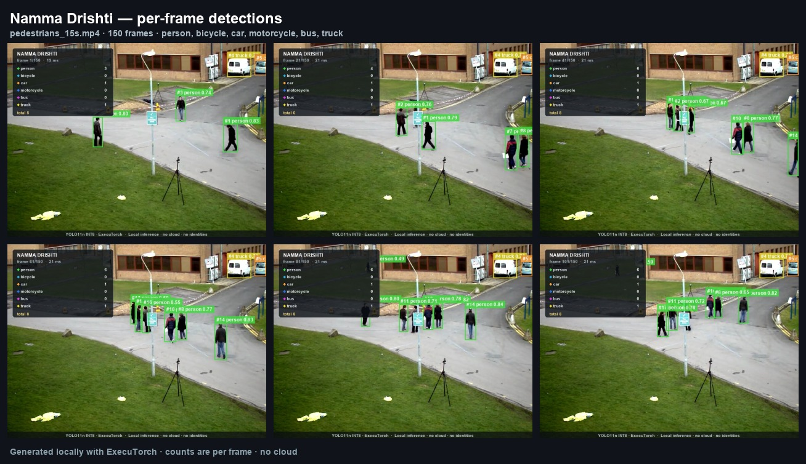
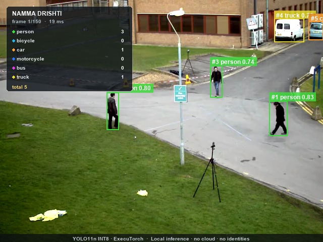
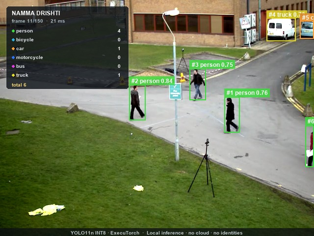
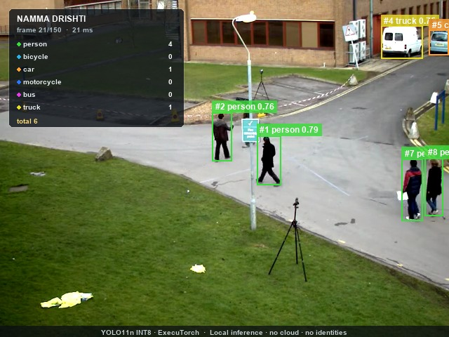
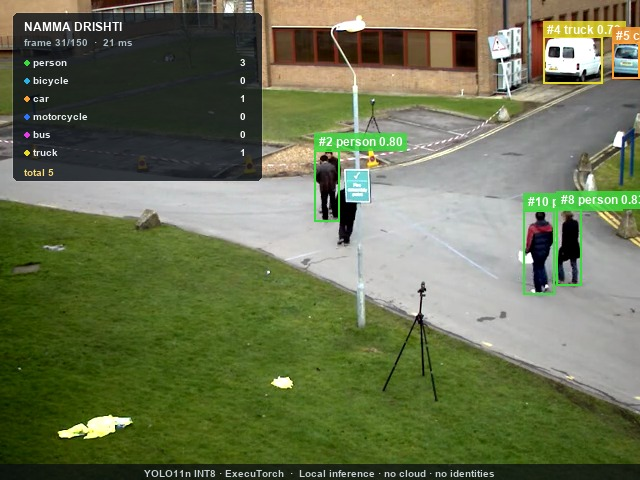

# Namma Drishti — run report

Offline pedestrian and vehicle counting with ExecuTorch on a Raspberry Pi. This report was generated from the run's `summary.json`.

## Run

- **Input:** `/Users/sujal/.t3/projects/edge-ai-detection/data/samples/pedestrians_15s.mp4`
- **Frames processed:** 150
- **Source:** 10.00 FPS, 640×480
- **Categories:** person, bicycle, car, motorcycle, bus, truck
- **Thresholds:** confidence 0.35, IoU 0.7
- **Tracking:** on (indicative)
- **Device:** arm64 · macOS-27.0.1-arm64-arm-64bit
- **Peak process RSS:** 610.5 MB

## Model

- **Name:** YOLO11n (COCO) — Arm-optimized INT8
- **Format:** ExecuTorch .pte, 4.73 MB
- **Backend:** XNNPACK (prebuilt with Arm KleidiAI kernels)
- **Quantization:** INT8 static post-training quantization; stem conv and detection head remain FP32 (per Arm model card)
- **SHA-256:** `154c54b52389219ebd982e1003227c1abbc3f29a99bdad241147b684d3041b96`
- **Source:** https://huggingface.co/Arm/yolo11n-int8-xnnpack-executorch-raspberrypi5
- **Reference accuracy (COCO val2017):** mAP@0.5:0.95 38.90%, mAP@0.5 54.66%

## Counts per frame

| Category | Peak/frame | Mean/frame | p95 | Total detections | Unique (indicative) |
|---|---:|---:|---:|---:|---:|
| person | 9 | 5.50 | 8 | 825 | 18 |
| bicycle | 0 | 0.00 | 0 | 0 | 0 |
| car | 1 | 1.00 | 1 | 150 | 1 |
| motorcycle | 0 | 0.00 | 0 | 0 | 0 |
| bus | 0 | 0.00 | 0 | 0 | 0 |
| truck | 1 | 1.00 | 1 | 150 | 1 |

> Counts are per processed frame. `Unique` comes from a lightweight IoU/velocity tracker and is indicative, not a production MOT count.

## Latency and throughput

| Stage | Mean (ms) | p50 (ms) | p95 (ms) | FPS from mean |
|---|---:|---:|---:|---:|
| Model inference | 20.71 | 20.68 | 21.36 | 48.29 |
| Preprocess | 0.59 | 0.57 | 0.65 | 1697.79 |
| Decode + NMS | 0.67 | 0.65 | 0.71 | 1484.61 |
| Frame read | 0.19 | 0.16 | 0.22 | 5145.61 |
| Annotate/save | 2.92 | 2.81 | 3.72 | 342.66 |
| Pipeline total | 25.39 | 25.20 | 26.29 | 39.38 |

- **Model-only:** 48.29 FPS
- **Pipeline:** 39.38 FPS
- **Wall time:** 3.90 s

## Exposure signals

- **Observed person-seconds:** 82.50
- **Observed vehicle-seconds:** 30.00
- **Frames with both people and vehicles:** 150 (100.0%)

> These are descriptive measures for the supplied clip, not extrapolations to a full day. A 15-second clip at school dismissal is a sample, not a traffic census.

## Evidence

- `counts.csv` — per-frame category counts and stage timings
- `detections.jsonl` — boxes, scores and optional track IDs
- `summary.json` — machine-readable summary
- `annotated/` — sample annotated frames

- `annotated.mp4` — annotated clip

## Reference benchmark (not this run)

Arm's model card reports **134.10 ms p50 / 7.46 FPS** on a Raspberry Pi 5 (ExecuTorch 1.1.0, XNNPACK + KleidiAI, 1 thread), with **59.17 MB** peak memory. Those numbers are a reference for the prebuilt model; the table above is the only latency measured in this run.

## Notes and limitations

- Counts are per processed frame, not unique objects, unless the 'unique_tracked' field is used.
- unique_tracked is indicative: a lightweight IoU/velocity tracker, not a production multi-object tracking system.
- Latency is measured on the device that produced this run. Compare only with runs on the same hardware and thread count.
- The model detects 80 COCO classes. Auto-rickshaws, carts and other India-specific categories are not guaranteed to be recognised.
- No faces, licence plates or identities are extracted. Frames are processed locally and only the requested evidence is written.
- Annotated-video encoding is an output convenience and is not included in the pipeline latency; model-only and per-stage timings are unaffected.
