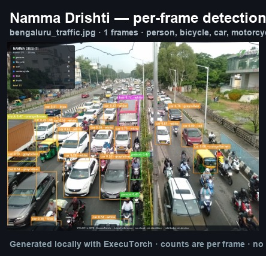
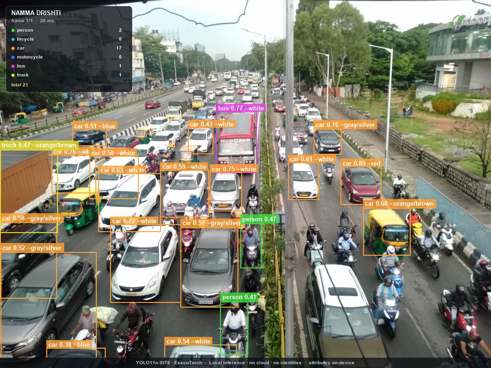

# Namma Drishti — run report

Offline pedestrian and vehicle counting with ExecuTorch on a Raspberry Pi. This report was generated from the run's `summary.json`.

## Run

- **Input:** `/Users/sujal/.t3/projects/edge-ai-detection/data/samples/bengaluru_traffic.jpg`
- **Frames processed:** 1
- **Categories:** person, bicycle, car, motorcycle, bus, truck
- **Thresholds:** confidence 0.35, IoU 0.7
- **Tracking:** off
- **Device:** arm64 · macOS-27.0.1-arm64-arm-64bit
- **Peak process RSS:** 450.6 MB

## Model

- **Name:** YOLO11n (COCO) — Arm-optimized INT8
- **Format:** ExecuTorch .pte, 4.73 MB
- **Backend:** XNNPACK (prebuilt with Arm KleidiAI kernels)
- **Quantization:** INT8 static post-training quantization; stem conv and detection head remain FP32 (per Arm model card)
- **SHA-256:** `154c54b52389219ebd982e1003227c1abbc3f29a99bdad241147b684d3041b96`
- **Source:** https://huggingface.co/Arm/yolo11n-int8-xnnpack-executorch-raspberrypi5
- **Reference accuracy (COCO val2017):** mAP@0.5:0.95 38.90%, mAP@0.5 54.66%

## Counts per frame

| Category | Peak/frame | Mean/frame | p95 | Total detections | Unique (indicative) |
|---|---:|---:|---:|---:|---:|
| person | 2 | 2.00 | 2 | 2 | — |
| bicycle | 0 | 0.00 | 0 | 0 | — |
| car | 17 | 17.00 | 17 | 17 | — |
| motorcycle | 0 | 0.00 | 0 | 0 | — |
| bus | 1 | 1.00 | 1 | 1 | — |
| truck | 1 | 1.00 | 1 | 1 | — |

> Counts are per processed frame. `Unique` comes from a lightweight IoU/velocity tracker and is indicative, not a production MOT count.

## Attributes alongside detections

These attributes are derived on-device from the tracker and a classical-CV colour heuristic. They are not trained attribute predictions and do not identify people.

| Class | Unique tracks | Direction (image-plane) | Colour estimate | Mean dwell | Mean speed |
|---|---:|---|---|---:|---:|
| car | 17 | — | blue 2, gray/silver 4, orange/brown 1, red 1, white 9 | — | — |
| bus | 1 | — | white 1 | — | — |
| truck | 1 | — | orange/brown 1 | — | — |

> Direction and speed are measured in the image plane; speed is uncalibrated pixels/second, not km/h. Colour applies only to vehicle crops and is a heuristic, not a trained attribute model. Compare directions within one fixed-camera clip, not across camera angles.

## Latency and throughput

| Stage | Mean (ms) | p50 (ms) | p95 (ms) | FPS from mean |
|---|---:|---:|---:|---:|
| Model inference | 20.38 | 20.38 | 20.38 | 49.06 |
| Preprocess | 2.50 | 2.50 | 2.50 | 400.24 |
| Decode + NMS | 7.54 | 7.54 | 7.54 | 132.62 |
| Frame read | 18.30 | 18.30 | 18.30 | 54.64 |
| Annotate/save | 13.99 | 13.99 | 13.99 | 71.48 |
| Pipeline total | 62.72 | 62.72 | 62.72 | 15.94 |

- **Model-only:** 49.06 FPS
- **Pipeline:** 15.94 FPS
- **Wall time:** 0.06 s

## Exposure signals

- **Observed person-seconds:** 0.00
- **Observed vehicle-seconds:** 0.00
- **Frames with both people and vehicles:** 1 (100.0%)

> These are descriptive measures for the supplied clip, not extrapolations to a full day. A 15-second clip at school dismissal is a sample, not a traffic census.

## Evidence

- `counts.csv` — per-frame category counts and stage timings
- `detections.jsonl` — boxes, scores and optional track IDs
- `summary.json` — machine-readable summary
- `annotated/` — sample annotated frames

- `attribute_tracks.csv` — per-track direction, dwell, speed and optional colour

- `attribute_summary.json` — aggregate attribute distributions

## Reference benchmark (not this run)

Arm's model card reports **134.10 ms p50 / 7.46 FPS** on a Raspberry Pi 5 (ExecuTorch 1.1.0, XNNPACK + KleidiAI, 1 thread), with **59.17 MB** peak memory. Those numbers are a reference for the prebuilt model; the table above is the only latency measured in this run.

## Notes and limitations

- Counts are per processed frame, not unique objects, unless the 'unique_tracked' field is used.
- unique_tracked is indicative: a lightweight IoU/velocity tracker, not a production multi-object tracking system.
- Latency is measured on the device that produced this run. Compare only with runs on the same hardware and thread count.
- The model detects 80 COCO classes. Auto-rickshaws, carts and other India-specific categories are not guaranteed to be recognised.
- No faces, licence plates or identities are extracted. Frames are processed locally and only the requested evidence is written.
- Annotated-video encoding is an output convenience and is not included in the pipeline latency; model-only and per-stage timings are unaffected.
- Direction and speed are image-plane attributes from the tracker. Speed is uncalibrated pixels/second, not km/h. Colour is an optional HSV heuristic on vehicle crops, not a trained attribute model.
