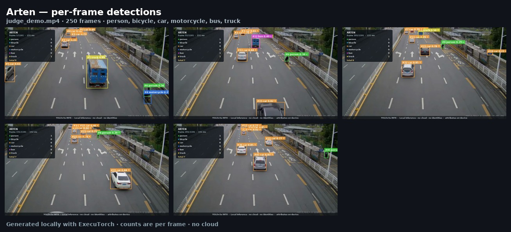
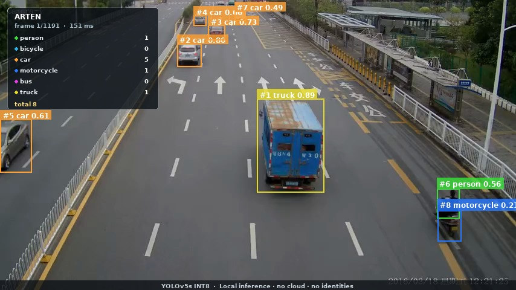
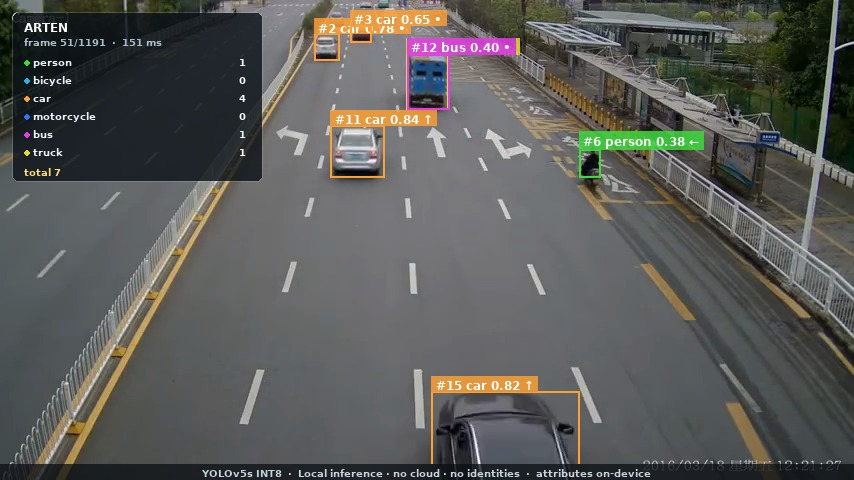
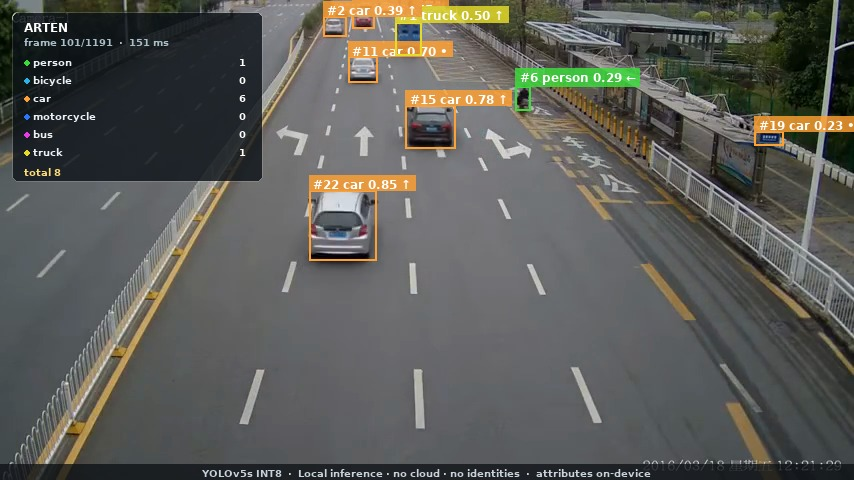
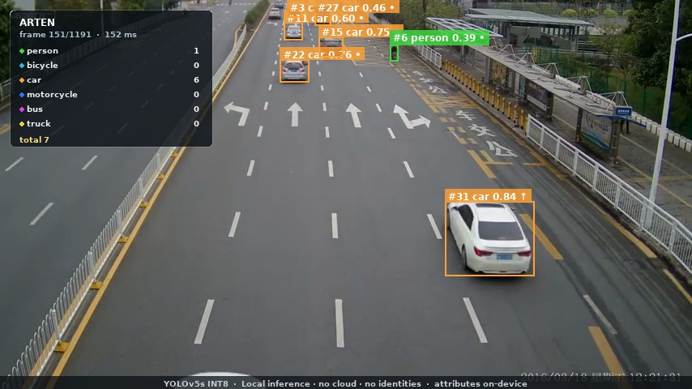

# Arten — Edge Object Detection, Counting & Attributes

**Run report**

Offline pedestrian and vehicle detection, counting and attribute analysis with ExecuTorch on a Raspberry Pi. This report was generated from the run's `summary.json`.

## Run

- **Input:** `/home/pi/judge_demo.mp4`
- **Frames processed:** 250
- **Source:** 25.00 FPS, 854×480
- **Categories:** person, bicycle, car, motorcycle, bus, truck
- **Thresholds:** confidence 0.2, IoU 0.5
- **Tracking:** on (indicative)
- **Device:** aarch64 · Linux-6.12.25+rpt-rpi-2712-aarch64-with-glibc2.36
- **Peak process RSS:** 537.5 MB

## Model

- **Name:** YOLOv5s (COCO) — Arm-optimized INT8
- **Format:** ExecuTorch .pte, 7.13 MB
- **Backend:** XNNPACK (CPU)
- **Quantization:** INT8 static post-training quantization; stem conv and detection head remain FP32 (per Arm model card)
- **SHA-256:** `40763869f4cd0dfb41b7d13e2d1f5c1b5f446dda34719e75d09bb87a352306c9`
- **Source:** https://huggingface.co/Arm/yolov5s-int8-xnnpack-executorch
- **Reference accuracy (COCO val2017):** mAP@0.5:0.95 36.09%, mAP@0.5 54.97%

## Counts per frame

| Category | Peak/frame | Mean/frame | p95 | Total detections | Unique (indicative) |
|---|---:|---:|---:|---:|---:|
| person | 2 | 0.93 | 1 | 233 | 3 |
| bicycle | 0 | 0.00 | 0 | 0 | 0 |
| car | 10 | 5.87 | 8 | 1468 | 25 |
| motorcycle | 1 | 0.02 | 0 | 6 | 2 |
| bus | 1 | 0.12 | 1 | 29 | 2 |
| truck | 2 | 0.60 | 1 | 151 | 8 |

> Counts are per processed frame. `Unique` comes from a lightweight IoU/velocity tracker and is indicative, not a production MOT count.

## Attributes alongside detections

These attributes are derived on-device from the tracker and a classical-CV colour heuristic. They are not trained attribute predictions and do not identify people.

| Class | Unique tracks | Direction (image-plane) | Colour estimate | Mean dwell | Mean speed |
|---|---:|---|---|---:|---:|
| truck | 8 | down 1, right 1, stationary 3, up 3 | — | 0.78 s | 69.9 px/s |
| car | 25 | down 4, left 3, right 1, stationary 14, up 3 | — | 2.39 s | 26.8 px/s |
| person | 3 | stationary 3 | — | 3.19 s | 10.4 px/s |
| motorcycle | 2 | left 1, up 1 | — | 0.16 s | 116.5 px/s |
| bus | 2 | up 2 | — | 0.88 s | 181.9 px/s |

> Direction and speed are measured in the image plane; speed is uncalibrated pixels/second, not km/h. Colour applies only to vehicle crops and is a heuristic, not a trained attribute model. Compare directions within one fixed-camera clip, not across camera angles.

## Latency and throughput

| Stage | Mean (ms) | p50 (ms) | p95 (ms) | FPS from mean |
|---|---:|---:|---:|---:|
| Model inference | 151.10 | 151.08 | 151.78 | 6.62 |
| Preprocess | 4.07 | 4.07 | 4.36 | 245.82 |
| Decode + NMS | 5.46 | 5.45 | 5.56 | 183.22 |
| Frame read | 1.40 | 1.17 | 2.20 | 714.94 |
| Annotate/save | 14.17 | 14.06 | 15.74 | 70.55 |
| Pipeline total | 177.56 | 177.40 | 180.15 | 5.63 |

- **Model-only:** 6.62 FPS
- **Pipeline:** 5.63 FPS
- **Wall time:** 45.51 s

## Exposure signals

- **Observed person-seconds:** 9.32
- **Observed vehicle-seconds:** 66.16
- **Frames with both people and vehicles:** 226 (90.4%)

> These are descriptive measures for the supplied clip, not extrapolations to a full day. A 15-second clip at school dismissal is a sample, not a traffic census.

## Evidence

- `counts.csv` — per-frame category counts and stage timings
- `detections.jsonl` — boxes, scores and optional track IDs
- `summary.json` — machine-readable summary
- `annotated/` — sample annotated frames

- `attribute_tracks.csv` — per-track direction, dwell, speed and optional colour

- `attribute_summary.json` — aggregate attribute distributions

- `annotated.mp4` — annotated clip

## Reference benchmark (not this run)

Arm's model card reports **258.07 ms p50 / 3.88 FPS** on a Raspberry Pi 5 (ExecuTorch 1.1.0, XNNPACK + KleidiAI), with **109.44 MB** peak memory. Those numbers are a reference for the prebuilt model; the table above is the only latency measured in this run.

## Notes and limitations

- Inference ran as a single 640x640 pass per frame.
- Counts are per processed frame, not unique objects, unless the 'unique_tracked' field is used.
- unique_tracked is indicative: a lightweight IoU/velocity tracker, not a production multi-object tracking system.
- Latency is measured on the device that produced this run. Compare only with runs on the same hardware and thread count.
- The model detects 80 COCO classes. Auto-rickshaws, carts and other India-specific categories are not guaranteed to be recognised.
- No faces, licence plates or identities are extracted. Frames are processed locally and only the requested evidence is written.
- Annotated-video encoding is an output convenience and is not included in the pipeline latency; model-only and per-stage timings are unaffected.
- Direction and speed are image-plane attributes from the tracker. Speed is uncalibrated pixels/second, not km/h. Colour is an optional HSV heuristic on vehicle crops, not a trained attribute model.
