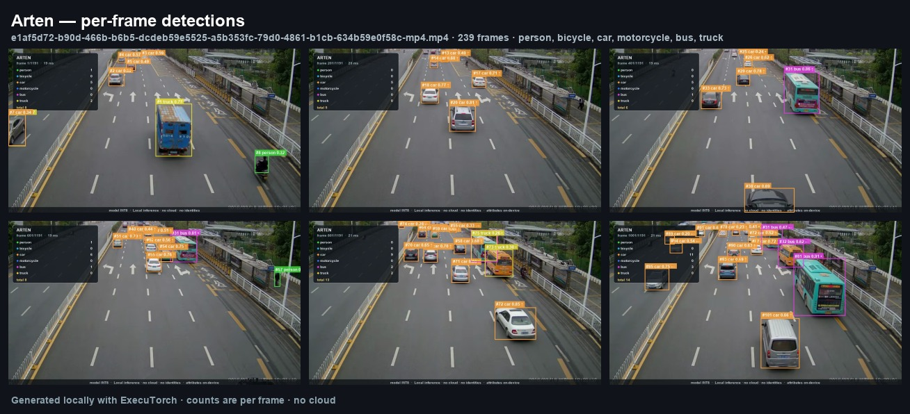

# Arten — Edge Object Detection, Counting & Attributes

**Run report**

Offline pedestrian and vehicle detection, counting and attribute analysis with ExecuTorch on a Raspberry Pi. This report was generated from the run's `summary.json`.

## Run

- **Input:** `/Users/sujal/.t3/userdata/attachments/e1af5d72-b90d-466b-b6b5-dcdeb59e5525-a5b353fc-79d0-4861-b1cb-634b59e0f58c-mp4.mp4`
- **Frames processed:** 239
- **Source:** 25.00 FPS, 854×480
- **Categories:** person, bicycle, car, motorcycle, bus, truck
- **Thresholds:** confidence 0.2, IoU 0.5
- **Tracking:** on (indicative)
- **Device:** arm64 · macOS-27.0.1-arm64-arm-64bit
- **Peak process RSS:** 518.1 MB

## Model

- **Name:** model (custom .pte)
- **Format:** ExecuTorch .pte, 3.08 MB
- **Backend:** XNNPACK (CPU)
- **Quantization:** unknown (custom .pte)
- **SHA-256:** `f65492c84a7422f23617b9f791a795e4c0f806d3553fbbb6527368645f9f3d3b`
- **Source:** None
- **Reference accuracy (COCO val2017):** mAP@0.5:0.95 38.90%, mAP@0.5 54.66%

## Counts per frame

| Category | Peak/frame | Mean/frame | p95 | Total detections | Unique (indicative) |
|---|---:|---:|---:|---:|---:|
| person | 2 | 0.50 | 1 | 119 | 11 |
| bicycle | 0 | 0.00 | 0 | 0 | 0 |
| car | 14 | 7.65 | 12 | 1829 | 54 |
| motorcycle | 1 | 0.03 | 0 | 6 | 0 |
| bus | 4 | 1.41 | 3 | 336 | 9 |
| truck | 2 | 0.27 | 1 | 65 | 9 |

> Counts are per processed frame. `Unique` comes from a lightweight IoU/velocity tracker and is indicative, not a production MOT count.

## Attributes alongside detections

These attributes are derived on-device from the tracker and a classical-CV colour heuristic. They are not trained attribute predictions and do not identify people.

| Class | Unique tracks | Direction (image-plane) | Colour estimate | Mean dwell | Mean speed |
|---|---:|---|---|---:|---:|
| car | 54 | down 9, left 8, right 5, stationary 13, up 19 | — | 6.78 s | 27.1 px/s |
| person | 11 | down 1, left 8, right 1, up 1 | — | 2.05 s | 34.7 px/s |
| truck | 9 | down 1, left 2, stationary 2, up 4 | — | 1.56 s | 63.2 px/s |
| bus | 9 | down 1, left 4, right 1, stationary 1, up 2 | — | 7.33 s | 12.1 px/s |

> Direction and speed are measured in the image plane; speed is uncalibrated pixels/second, not km/h. Colour applies only to vehicle crops and is a heuristic, not a trained attribute model. Compare directions within one fixed-camera clip, not across camera angles.

## Latency and throughput

| Stage | Mean (ms) | p50 (ms) | p95 (ms) | FPS from mean |
|---|---:|---:|---:|---:|
| Model inference | 19.98 | 19.74 | 22.03 | 50.04 |
| Preprocess | 0.69 | 0.63 | 0.92 | 1446.46 |
| Decode + NMS | 0.62 | 0.60 | 0.69 | 1600.97 |
| Frame read | 0.31 | 0.20 | 0.68 | 3246.02 |
| Annotate/save | 3.22 | 3.11 | 4.14 | 310.64 |
| Pipeline total | 25.49 | 24.78 | 28.95 | 39.23 |

- **Model-only:** 50.04 FPS
- **Pipeline:** 39.23 FPS
- **Wall time:** 6.51 s

## Exposure signals

- **Observed person-seconds:** 23.80
- **Observed vehicle-seconds:** 447.20
- **Frames with both people and vehicles:** 115 (48.1%)

> These are descriptive measures for the supplied clip, not extrapolations to a full day. A 15-second clip at school dismissal is a sample, not a traffic census.

## Evidence

- `counts.csv` — per-frame category counts and stage timings
- `detections.jsonl` — boxes, scores and optional track IDs
- `summary.json` — machine-readable summary
- `annotated/` — sample annotated frames

- `attribute_tracks.csv` — per-track direction, dwell, speed and optional colour

- `attribute_summary.json` — aggregate attribute distributions

- `annotated.mp4` — annotated clip

## Reference benchmark (not this run)

Arm's model card reports **134.10 ms p50 / 7.46 FPS** on a Raspberry Pi 5 (ExecuTorch 1.1.0, XNNPACK + KleidiAI, 1 thread), with **59.17 MB** peak memory. Those numbers are a reference for the prebuilt model; the table above is the only latency measured in this run.

## Notes and limitations

- Inference ran as a single 640x640 pass per frame.
- Counts are per processed frame, not unique objects, unless the 'unique_tracked' field is used.
- unique_tracked is indicative: a lightweight IoU/velocity tracker, not a production multi-object tracking system.
- Latency is measured on the device that produced this run. Compare only with runs on the same hardware and thread count.
- The model detects 80 COCO classes. Auto-rickshaws, carts and other India-specific categories are not guaranteed to be recognised.
- No faces, licence plates or identities are extracted. Frames are processed locally and only the requested evidence is written.
- Annotated-video encoding is an output convenience and is not included in the pipeline latency; model-only and per-stage timings are unaffected.
- Direction and speed are image-plane attributes from the tracker. Speed is uncalibrated pixels/second, not km/h. Colour is an optional HSV heuristic on vehicle crops, not a trained attribute model.
